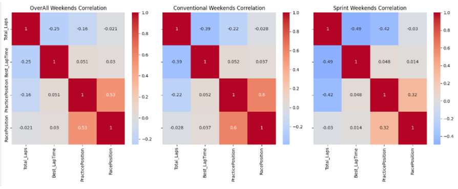

# Do F1 Sprint Weekends Hurt Race Performance?

A statistical analysis of the 2024 Formula 1 season, testing whether the reduced practice time on sprint weekends affects race results.

## The question

A conventional F1 weekend has three free practice sessions before qualifying and the race. A sprint weekend has only one, replacing the others with a sprint qualifying session and a short sprint race. Sprints draw bigger audiences, but drivers and teams often argue the lost practice time hurts their preparation.

**Does the data back them up?** This project compares practice and race performance across all 24 rounds of the 2024 season to see whether sprint weekends show a measurable penalty.

## Data

- **Source:** [FastF1](https://github.com/theOehrly/Fast-F1), a Python library for official F1 timing data
- **Scope:** 2024 season, 24 rounds (sprint and conventional weekends)
- **Practice data:** each driver's fastest valid lap and total laps per session (laps marked deleted or inaccurate are excluded)
- **Race data:** finishing position per driver
- Drivers with no race result that weekend (for example, reserve drivers in FP1) are excluded

## Methods

1. **Data pipeline:** functions to load the season schedule, practice sessions and race results with FastF1, using a local cache. Sessions that don't exist on a given weekend are skipped cleanly.
2. **Practice performance score:** for each round, fastest lap and laps completed are normalized (circuits differ in length), then combined with weights of 0.7 for lap time and 0.3 for laps completed. Drivers are ranked on this score to give a *practice position*.
3. **Exploratory analysis:** distribution of practice-to-race position change, scatter plots by round and by driver, best lap time vs. race position, and correlation heatmaps for all weekends, sprint only and conventional only.
4. **Statistical testing:**
   - Shapiro–Wilk test for normality
   - Linear regression of race position on practice position
   - Spearman rank correlation, which suits the non-normal data
   - Mixed linear model with event format, laps completed, best lap time and practice position as predictors

## Key results

| Test | Result |
| --- | --- |
| Shapiro–Wilk (position change) | W = 0.991, p = 0.004, so the data is not normal and rank-based tests are used |
| Linear regression | R² = 0.26, MSE = 26.4 (about 5 positions of error) |
| Practice vs. race position correlation | 0.53 overall, 0.60 conventional, 0.32 sprint |
| Spearman test | Significant in all three groups (p < 0.05) |
| Mixed linear model | Practice position is a significant predictor; event format, laps completed and best lap time are not |



*Practice position is the only variable that tracks race position, and the link is weakest on sprint weekends.*

## Conclusion

In 2024, sprint weekends showed **no measurable penalty** to race performance. The practice score predicted race results moderately well on both weekend types, but whether a weekend was a sprint did not significantly change results. A likely reason is that drivers know most circuits well and teams rely on advanced simulators.

**Limitation:** the 2024 season had no rookies racing full time. A useful next step would be to repeat the analysis on a season where several rookies faced sprint weekends with less track experience.

## How to run

```bash
pip install fastf1 pandas numpy matplotlib seaborn scipy scikit-learn statsmodels
```

Open `DATA720_TaylorStafford_FinalProject.ipynb` and run all cells. The first run downloads the 2024 data into a local `f1_cache` folder, which takes a few minutes; later runs load from the cache.

## Tools

Python · FastF1 · pandas · NumPy · SciPy · statsmodels · scikit-learn · Matplotlib · seaborn

---

*Completed as the final project for DATA 720 at the University of North Carolina at Chapel Hill (Nov 2025).*
